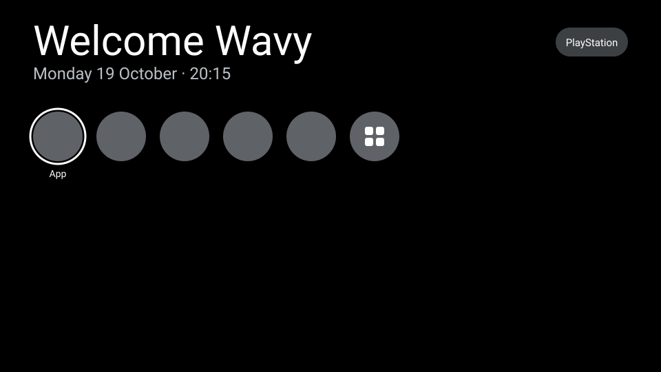
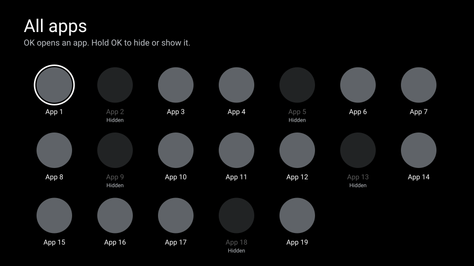

# Bare

A small, fast home screen for Google TV and Android TV. It shows a greeting, the date and time, and your apps. No ads, no recommendations, no network.



## What it does

- Shows your TV apps as a row of round icons, sorted by name
- "PlayStation" button switches the TV to HDMI 1
- Hold OK on an app to hide it
- "All apps" opens every app in a grid: OK opens an app, hold OK hides or shows it
- Becomes the TV's home screen, so it shows on Home and when the TV turns on



## Requirements

- A TV on Android 11 or newer with Developer options and network debugging on
- JDK 17 and the Android SDK (Android Studio installs both)

## Install on your TV

Connect to the TV over your network. Find the IP under Settings > Network on the TV.

```
adb connect <tv-ip>:5555
```

Accept the "Allow debugging?" prompt on the TV. Then build and install the release build:

```
./gradlew installRelease
```

## Make it the home screen

Google TV does not let you pick another home app in Settings. This script turns off the Google TV home screen and its setup app, so Bare is the only home screen left:

```
./scripts/set-home.sh
```

The script stops if Bare is not installed, so the TV never ends up without a home screen. A system update can turn Google TV's home back on. Run the script again when that happens.

To go back to the Google TV home screen:

```
./scripts/restore-home.sh
```

The remote's Settings button keeps working with Bare as home.

## Development

```
./gradlew lint testDebugUnitTest assembleDebug
```

- Kotlin and Jetpack Compose for TV, one activity, no network
- Hidden apps are stored in `SharedPreferences` on the TV
- The release build is signed with the debug key, so it installs as an update over a debug build and keeps the hidden apps
- Every change is planned in `openspec/`: proposals, specs and tasks per feature

## Troubleshooting

**`adb connect` says "No route to host" on macOS.** macOS blocks local network access for apps without permission. Run adb from Terminal.app and allow it under System Settings > Privacy & Security > Local Network. To use a separate adb server that Terminal started, set the port in every shell:

```
export ANDROID_ADB_SERVER_PORT=5038
```
